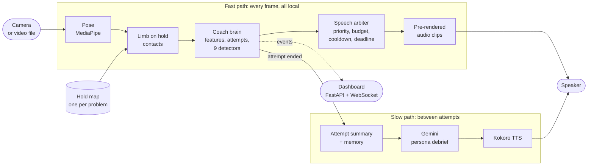

<a id="readme-top"></a>

[![Contributors][contributors-shield]][contributors-url]
[![Issues][issues-shield]][issues-url]
[![CI][ci-shield]][ci-url]
[![MIT License][license-shield]][license-url]

<br />
<div align="center">
  <h3 align="center">Chalkbot</h3>

  <p align="center">
    Chalkbot is a real-time AI bouldering coach. A fixed camera watches a climber. While they climb, the coach speaks short cues about what it sees, such as feet left low, arms bent too long, or a hand searching for a hold. Between attempts it gives a spoken debrief in character, and it remembers earlier attempts. The live loop runs entirely on the local machine. It turns a camera frame into a spoken line handed to the audio device in a median of 47 ms.
    <br />
    <a href="docs/BENCHMARKS.md"><strong>Benchmarks and how they were measured</strong></a>
    &middot;
    <a href="docs/LAYER-INTERFACES.md">Layer interfaces</a>
    &middot;
    <a href="https://github.com/Amrovv/WHACK-IO-26/issues">Report a bug</a>
  </p>
</div>

<details>
  <summary>Contents</summary>
  <ol>
    <li><a href="#about-the-project">About the project</a>
      <ul>
        <li><a href="#documentation">Documentation</a></li>
        <li><a href="#built-with">Built with</a></li>
      </ul>
    </li>
    <li><a href="#architecture">Architecture</a></li>
    <li><a href="#results">Results</a></li>
    <li><a href="#getting-started">Getting started</a></li>
    <li><a href="#tests-and-benchmarks">Tests and benchmarks</a></li>
    <li><a href="#limitations">Limitations</a></li>
    <li><a href="#future-work">Future work</a></li>
    <li><a href="#contributing">Contributing</a></li>
    <li><a href="#license">License</a></li>
    <li><a href="#contact">Contact</a></li>
    <li><a href="#acknowledgments">Acknowledgments</a></li>
  </ol>
</details>

## About the project

Built in 24 hours by a team of four at a hackathon, for incident.io's "Live commentator"
challenge: commentary that keeps up with something happening live. Ours watches someone climbing
a bouldering problem.

Commentary only helps a climber if it arrives while the move is still happening. The coach therefore works at two speeds:

* **During a climb**, every camera frame goes through pose estimation, a check of which limb
  is on which hold, and a set of detectors for common technique faults. When one fires, an
  arbiter decides whether it is worth saying now, and plays a line that was rendered to audio
  in advance. The loop makes no network calls and no LLM calls, and it does no slow work.
* **Between attempts**, a summary of the attempt goes to Gemini, which writes a short debrief
  in the coach's persona. Kokoro reads it out. The coach remembers what it told you last time
  and notices when you repeat a mistake.

The coach knows the problem being climbed. A hold map is built once per problem from a photo of the empty wall:
a Roboflow hold detector, filtered to the colour of one hold the user clicks on, then fixed by hand in the dashboard.
Holds are numbered from the bottom, so the coach can say "you got to hold 7" or "the crux is coming".

**My part.** I (Adam Wasiak) owned the coach brain, `coach/brain/`, which turns pose and contacts
into coaching decisions. That covers the movement features, attempt tracking (start, top, fall,
downclimb), the nine technique detectors, the speech arbiter that decides what gets said and when,
and the attempt memory behind the debriefs. I also own the shared contracts in
`coach/contracts.py`. After the hackathon I fixed the bugs that the end-to-end benchmark
exposed, and I wrote the benchmark, CI and this README. Perception, voice and the dashboard
were built by the other three.

<p align="right">(<a href="#readme-top">back to top</a>)</p>

### Documentation

| Document | Holds |
|---|---|
| [Benchmarks](docs/BENCHMARKS.md) | Latency from frame to audio, cost per stage, a per-clip scenario check, the misses, and what the numbers do and do not measure. |
| [Layer interfaces](docs/LAYER-INTERFACES.md) | What crosses each boundary between perception, brain, voice and server, and in what shape. |
| [Integration contract](docs/INTEGRATION-contract.md) | Exactly how `run.py` wires the coach brain into the rest. |
| [Test climbs](TEST_CLIMBS.md) | The clips we filmed, and what each was filmed to provoke. |
| [Data](data/README.md) and [models](models/README.md) | What lives in `data/` and `models/`, what is in git and where the rest comes from. |
| [Contributing](CONTRIBUTING.md) | The team's git workflow and folder ownership. |

<p align="right">(<a href="#readme-top">back to top</a>)</p>

### Built with

* [![Python][python-shield]][python-url]
* [![uv][uv-shield]][uv-url]
* [![MediaPipe][mediapipe-shield]][mediapipe-url]
* [![OpenCV][opencv-shield]][opencv-url]
* [![Roboflow][roboflow-shield]][roboflow-url]
* [![Gemini][gemini-shield]][gemini-url]
* [![FastAPI][fastapi-shield]][fastapi-url]
* [![pytest][pytest-shield]][pytest-url]
* [![GitHub Actions][actions-shield]][actions-url]

Kokoro (text to speech), NumPy, sounddevice and Ruff.

<p align="right">(<a href="#readme-top">back to top</a>)</p>

## Architecture



Threads pass work through queues that hold one item and drop the oldest. That way the pipeline always works
on the newest frame and never falls behind. Every cue has a deadline. If its audio cannot start
within 200 ms it is dropped, because late advice about a move that is already done is worse than none.
The brain uses only capture timestamps, never the wall clock, so recorded poses replay through it
exactly as they did live.

| Module | Holds |
|---|---|
| `coach/sources` | Camera and file readers and the one-slot queue |
| `coach/perception` | MediaPipe pose, smoothing, left/right fixes, hold maps, limb-to-hold contacts |
| `coach/brain` | Movement features, attempt tracking, the detectors, the speech arbiter, attempt memory |
| `coach/voice` | Phrase bank, persona, Kokoro TTS and audio cache, Gemini debriefs, audio output |
| `coach/server`, `web/` | FastAPI server and the live dashboard: video with overlay, captions, latency, attempt history, hold map editor |
| `coach/contracts.py` | The dataclasses that cross every module boundary |
| `config/default.yaml` | Every threshold; no magic numbers in code |
| `run.py` | Wires it all together, live or from a clip |

<p align="right">(<a href="#readme-top">back to top</a>)</p>

## Results

Measured on 32 clips (16.1 minutes of the team's own footage), played in real time through the
full pipeline on one desktop CPU (i5-9600K, no GPU). Full tables and method in
[`docs/BENCHMARKS.md`](docs/BENCHMARKS.md).

| | |
|---|---|
| Cues spoken | 164 |
| **Frame captured to line handed to the audio device** | **median 47 ms, p95 78 ms, max 93 ms** |
| Plus the audio device's output buffer (sound card and driver, 93 ms here) | median 140 ms, p95 171 ms, max 186 ms; all 164 inside the 800 ms target |
| Cues dropped for missing the 200 ms start deadline | 5 |
| Pose inference per frame | 30.9 ms median, 87% of a frame's cost |
| Coach brain per frame | 0.1 ms median, 0.4% of a frame's cost |
| Throughput on one thread | 28.2 frames per second |
| Clips showing what they were filmed to show | 14 of 22 |

The headline latency is the coach's own work: pose, hold contacts, the brain, the arbiter and the
voice picking the line. The audio device's output buffer is reported separately, because it
depends on the sound hardware and driver rather than on this code. Neither figure includes the
camera itself, any wireless headset, or the detectors' deliberate debounce of about 400 ms.
The scenario check is a smoke test with one clip per scenario, not an accuracy figure. Its
eight misses are listed in the benchmark report.

<p align="right">(<a href="#readme-top">back to top</a>)</p>

## Getting started

Needs [uv](https://docs.astral.sh/uv/), which installs Python 3.12 for you. The first `uv sync`
downloads about 1 GB (torch for Kokoro, MediaPipe).

```sh
git clone https://github.com/Amrovv/WHACK-IO-26.git
cd WHACK-IO-26
uv sync
```

**1. The pose model.** It is not in git. Download it once (see [`models/README.md`](models/README.md)):

```sh
curl -L -o models/pose_landmarker_full.task https://storage.googleapis.com/mediapipe-models/pose_landmarker/pose_landmarker_full/float16/latest/pose_landmarker_full.task
```

**2. A clip.** Put footage in `videos/`, named `<problem>_<clip no>_<name>.mp4`, for example
`videos/climb_1_02_clean_send.mp4`. Hold maps for problems `climb_1` to `climb_16` are in git. For a
new wall, open the dashboard and build a hold map from clip `00`, a shot of the empty wall
(this needs `ROBOFLOW_API_KEY`). The team's footage is not public.

**3. Run it, with cues printed instead of spoken.** This needs no audio setup:

```sh
uv run python run.py --source file:videos/climb_1_02_clean_send.mp4 --problem climb_1 --voice print --no-llm
```

Then open <http://localhost:8000> for the dashboard. `--source cam:0` uses a webcam instead.

**4. Spoken cues.** Kokoro needs spaCy's English model. `uv sync` removes it because it is not
a declared dependency, so reinstall it after every sync:

```sh
uv pip install "en_core_web_sm @ https://github.com/explosion/spacy-models/releases/download/en_core_web_sm-3.8.0/en_core_web_sm-3.8.0-py3-none-any.whl"
```

Then pre-render every line in the phrase bank, so that no cue has to be synthesised live. This
takes a few minutes the first time:

```sh
uv run python -m scripts.build_phrasebank --render   # renders the bank as it is; no API key needed
uv run python -m scripts.build_phrasebank --check    # every clip should be cached
```

Then drop `--voice print` from the run command.

**5. Written debriefs.** Copy `.env.example` to `.env` and set `GEMINI_API_KEY`. Without it,
debriefs fall back to a template, the same as `--no-llm`.

<p align="right">(<a href="#readme-top">back to top</a>)</p>

## Tests and benchmarks

```sh
uv run ruff format . && uv run ruff check .
uv run pytest
```

Tests that need footage, the pose model or an audio device skip themselves, so the suite passes
on a fresh clone. CI runs it on Linux and Windows.

Recorded poses can be replayed through the brain without video or a model:

```sh
uv run python run.py --replay-pose data/pose_cache/<clip>.jsonl --problem <id> --voice print
```

The benchmark needs the clips, the model and the audio cache. Each run takes about 20 minutes:

```sh
uv run python -m scripts.bench_pipeline e2e --out docs/benchmarks/e2e.json         # real time, muted audio
uv run python -m scripts.bench_pipeline stages --out docs/benchmarks/stages.json   # cost of each stage
uv run python -m scripts.bench_pipeline report docs/benchmarks/stages.json docs/benchmarks/e2e.json
```

<p align="right">(<a href="#readme-top">back to top</a>)</p>

## Limitations

* **Detection is heuristic and tuned on little footage.** Eight of the 22 scenario clips miss what
  they were filmed to show. The misses include falls classed as downclimbs, and attempts that
  never close before the clip ends.
* **One camera, one climber.** A spotter or passer-by in frame can be picked up as the climber.
  Poor lighting, or clothing the same colour as the holds, makes contacts less reliable.
* **Latency is estimated, not recorded.** It is measured from software timestamps and the
  output latency PortAudio reports, not with a microphone, and it excludes the camera and any headset.
* **One machine.** All figures are from one CPU-only desktop on Windows.
* **Hold maps are per problem** and need a photo of the empty wall plus some hand correction.

<p align="right">(<a href="#readme-top">back to top</a>)</p>

## Future work

* **Measure detector accuracy properly.** Label footage frame by frame and report precision and
  recall per detector, in place of one smoke-test clip per scenario.
* **Attempt endings from more than the hip.** Use hand contacts and the drop speed to tell
  falls from downclimbs.
* **Measure latency end to end.** Use a microphone and a visible event on camera (a light, a clap) to include the camera and
  speaker delay.
* **Run on a laptop GPU, or with the lite pose model.** Pose inference is 87% of the cost of a frame.

<p align="right">(<a href="#readme-top">back to top</a>)</p>

## Contributing

Built by four people in 24 hours. Each person owned one folder (perception, coach brain, voice and
persona, product and dashboard), and work went in through feature branches and pull requests.
[`CONTRIBUTING.md`](CONTRIBUTING.md) has the workflow.

<p align="right">(<a href="#readme-top">back to top</a>)</p>

## License

Distributed under the MIT License. See [`LICENSE.txt`](LICENSE.txt) for more information.

<p align="right">(<a href="#readme-top">back to top</a>)</p>

## Contact

Adam Wasiak, adamwasiak55@gmail.com

Project link: [https://github.com/Amrovv/WHACK-IO-26](https://github.com/Amrovv/WHACK-IO-26)

<p align="right">(<a href="#readme-top">back to top</a>)</p>

## Acknowledgments

* The team: Platon, Andrii and Daniel, who built perception, voice and the dashboard.
* [incident.io](https://incident.io/), for the "Live commentator" challenge.
* [MediaPipe Pose Landmarker](https://ai.google.dev/edge/mediapipe/solutions/vision/pose_landmarker),
  [Kokoro](https://huggingface.co/hexgrad/Kokoro-82M) and [Roboflow](https://roboflow.com/).
* [Best README Template](https://github.com/othneildrew/Best-README-Template), which this README is structured from.

<p align="right">(<a href="#readme-top">back to top</a>)</p>

[contributors-shield]: https://img.shields.io/github/contributors/Amrovv/WHACK-IO-26.svg?style=for-the-badge
[contributors-url]: https://github.com/Amrovv/WHACK-IO-26/graphs/contributors
[issues-shield]: https://img.shields.io/github/issues/Amrovv/WHACK-IO-26.svg?style=for-the-badge
[issues-url]: https://github.com/Amrovv/WHACK-IO-26/issues
[license-shield]: https://img.shields.io/github/license/Amrovv/WHACK-IO-26.svg?style=for-the-badge
[license-url]: https://github.com/Amrovv/WHACK-IO-26/blob/main/LICENSE.txt
[ci-shield]: https://img.shields.io/github/actions/workflow/status/Amrovv/WHACK-IO-26/ci.yml?style=for-the-badge&label=CI
[ci-url]: https://github.com/Amrovv/WHACK-IO-26/actions/workflows/ci.yml
[python-shield]: https://img.shields.io/badge/Python%203.12-3776AB?style=for-the-badge&logo=python&logoColor=white
[python-url]: https://www.python.org/
[uv-shield]: https://img.shields.io/badge/uv-DE5FE9?style=for-the-badge&logo=uv&logoColor=white
[uv-url]: https://docs.astral.sh/uv/
[mediapipe-shield]: https://img.shields.io/badge/MediaPipe-0097A7?style=for-the-badge&logo=google&logoColor=white
[mediapipe-url]: https://ai.google.dev/edge/mediapipe
[opencv-shield]: https://img.shields.io/badge/OpenCV-5C3EE8?style=for-the-badge&logo=opencv&logoColor=white
[opencv-url]: https://opencv.org/
[roboflow-shield]: https://img.shields.io/badge/Roboflow-6706CE?style=for-the-badge&logo=roboflow&logoColor=white
[roboflow-url]: https://roboflow.com/
[gemini-shield]: https://img.shields.io/badge/Gemini-8E75B2?style=for-the-badge&logo=googlegemini&logoColor=white
[gemini-url]: https://ai.google.dev/
[fastapi-shield]: https://img.shields.io/badge/FastAPI-009688?style=for-the-badge&logo=fastapi&logoColor=white
[fastapi-url]: https://fastapi.tiangolo.com/
[pytest-shield]: https://img.shields.io/badge/pytest-0A9EDC?style=for-the-badge&logo=pytest&logoColor=white
[pytest-url]: https://docs.pytest.org/
[actions-shield]: https://img.shields.io/badge/GitHub%20Actions-2088FF?style=for-the-badge&logo=githubactions&logoColor=white
[actions-url]: https://github.com/features/actions
